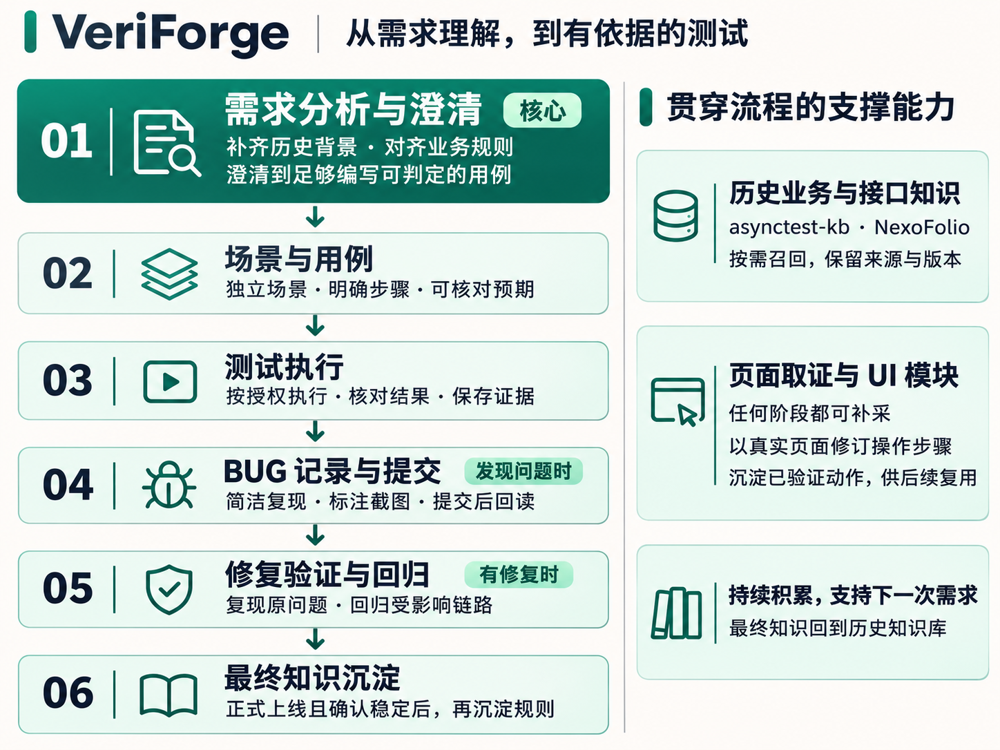

<div align="center">

# VeriForge

### 让需求、用例、执行和缺陷，连成一条有依据的测试流程。

面向 AI Agent 的 Web 测试工作流 Skill。<br>
用自然语言开始工作，把项目理解、执行证据和进度留在可交接的工作空间中。

**需求澄清 · 历史知识 · 可执行用例 · 页面取证 · BUG 复验**

[快速开始](#快速开始) · [工作流程](#工作流程) · [工具接入](#按需接入工具) · [数据与隐私](#数据与隐私) · [版本与验收](#版本与验收)

</div>

---

## VeriForge 帮你做什么

测试经常卡在上下文上：需求中一个没有解释的角色、旧版本的一条限制、页面已经变化的操作步骤，都会影响后续的用例和结论。换一个会话或换一个人接手，又要重新补一遍背景。

VeriForge 给 Agent 一套从需求到复验的工作方法，并提供本地记录工具。Agent 会先读已有资料，主动寻找相关历史规则，围绕真正影响测试的问题与你澄清，再组织能阅读、能讲解、能执行的场景。过程中保存来源、页面信息、证据和未完成事项，下一次可以接着做。

| 你的目标 | VeriForge 如何协助 | 留下什么 |
| --- | --- | --- |
| 理解一项需求 | 对齐概念、角色、状态、变化与验收条件；查询相关历史 | 有来源的结论、影响范围和关键待确认项 |
| 编写能直接使用的用例 | 按业务场景组织，每个场景有准备、步骤和预期 | 思维导图或你指定格式的用例 |
| 让 Agent 执行页面测试 | 按授权使用专用无界面浏览器，复用已验证 UI 模块 | 场景结果、证据、同步状态和恢复记录 |
| 发现并处理 BUG | 简洁描述复现过程，附标注截图，核对实际提交结果 | 预提交 BUG、工单关联及复验依据 |
| 新成员接手旧项目 | 从本地摘要、历史业务知识和接口知识补背景 | 可追溯的项目理解与下一步 |
| 同时测多个系统 | 区分被测项目、系统、需求、环境、角色和任务 | 各自独立的记录及显式共享规则 |

主要交付围绕 **测试用例、最终知识内容和你额外要求的产物**。不默认制造一整套没人会看的报告；BUG、执行证据和断点按实际工作需要留下。

## 快速开始

### 1. 让你的 Agent 安装

将下面整段话复制给支持 Agent Skills 的客户端，话术已包含 GitHub 地址、分支和需要安装的目录：

> 请从 https://github.com/SheldonParsons/VeriForge 的 `main` 分支帮我安装 VeriForge。先读取仓库的 `README.md` 和 `skills/qa-workflow/SKILL.md`，确认当前客户端的 Skill 安装位置，并检查 Node.js 20.19+ 和 npm。将仓库中的整个 `skills/qa-workflow/` 目录安装为 `qa-workflow`，保留其中的脚本、参考文档和资源，在安装后的目录运行 `npm ci --omit=dev`。再运行 `node scripts/qa.mjs --version` 和 `node scripts/qa.mjs --capabilities`，检查当前客户端是否能发现这个 Skill，告诉我安装结果和怎么开始。保留我已有的配置，暂时不要接入真实业务账号或执行测试。

安装来源：[GitHub 仓库](https://github.com/SheldonParsons/VeriForge) · [Skill 目录](https://github.com/SheldonParsons/VeriForge/tree/main/skills/qa-workflow)。安装整个目录，不能只复制 `SKILL.md`。

VeriForge 的品牌名称与 Skill 标识不同：**品牌为 VeriForge，调用标识为 `qa-workflow`**。包使用标准的 `SKILL.md`、`scripts/`、`references/`、`assets/` 结构；宿主如何发现 Skill、是否需要重载，由当前 Agent 按客户端实际能力处理。参见 [Agent Skills 格式](https://agentskills.io/specification)。

**运行要求：Node.js 20.19+、npm、允许读取本地项目文件。** 阅读规则不需要一次性连接所有 MCP；运行本地工具前需要安装锁定依赖。候选包不包含 `node_modules`，安装通常需要网络。截图标注使用 sharp，其支持范围取决于操作系统和架构。

<details>
<summary>手动安装与验证</summary>

从仓库复制 `skills/qa-workflow/`，或解压 `veriforge-0.4.0-rc.2.zip`，将里面的 `qa-workflow/` 放进当前 Agent 的 Skill 目录。在安装后的目录执行：

```sh
npm ci --omit=dev
node scripts/qa.mjs --version
node scripts/qa.mjs --capabilities
```

仓库还提供 `node tools/install.mjs --target /目标目录/qa-workflow`：只复制到新的明确目标，目标已存在则停止，不覆盖已有版本。安装后仍需在目标内执行 `npm ci --omit=dev`。测试项目资料放在另外的工作空间目录，不能放入安装目录。

升级前备份工作空间，停止旧执行者并核对在途动作，再在新目录验证新版本。数据格式升级是显式动作；读取旧记录不会顺便迁移。删除 Skill 安装目录不会删除另外保存的工作空间和私密库。

</details>

### 2. 用你平时的话开始

> 我有一个新需求，帮我先看看哪些地方需要问清楚。这是需求说明和原型。

> 我刚接手这个项目。先看看已有知识和接口资料，再帮我理解这个审批功能。

> 用例写好了，但页面刚部署到测试环境。帮我核对操作步骤，再开始执行。

> 继续昨天没测完的部分，先告诉我停在哪里。

不需要先掌握命令或填写复杂表单。Agent 应先读取已有信息，只补问缺少的关键内容。需要明确调用时，可以说“使用 VeriForge”，或在支持该语法的客户端使用 `$qa-workflow`。

### 3. 到需要时再配置工具

一开始有项目目录和需求资料，就可以讨论需求。需要看页面时再配置浏览器和环境，需要写思维导图时再连接 Mind，需要提交工单时再核对缺陷平台。账号、地址和权限来自你自己的项目配置，安装包不预置任何组织的业务账号或实例地址。

## 工作流程



**需求分析是核心。** Agent 要理解术语、角色、旧规则与实际变化，直到能够说明“谁在什么条件下做什么，以及怎样判断结果”。澄清到足够写出可判定场景即可；无关背景和不影响当前场景的问题不无限追问。

**页面取证可以随时发生。** 新页面还没部署时，先结合已有页面和需求说明形成待核实步骤；部署后补采真实入口、控件、字段与反馈，再修订用例。取证得到的可复用动作进入限定范围的 UI 模块，减少重复观察。

**用例写完就可以拿去评审。** 推荐按独立场景组织，操作步骤在每个场景从 1 开始。尊重你已有的用例格式，但始终保留可执行步骤和明确预期；改动局部功能时，也覆盖少量关联历史流程和完整业务链路。

**执行靠证据判断。** 通过、失败、阻塞、未执行、待核实分别保存。成功提示或 HTTP 200 不能替代实际业务状态。用例结果、思维导图标记、BUG 提交状态和测试数据恢复互相有关，但不是同一件事。

**知识在适当时机沉淀。** 过程结论持续保存在本地；本期正式上线且确认短期稳定后，强烈推荐整理为可复用规则写入 asynctest-kb。后续需求能主动读到这些背景，不必每次从头解释。

## 从历史知识补齐项目理解

一个刚接手项目的人不需要先把过去的所有需求讲一遍。配置可访问的知识来源后，Agent 会先概览、再按当前任务定向查阅：

- **asynctest-kb**：业务概念、角色权限、状态流转、历史变更、验收规则和限制。
- **NexoFolio**：对应项目与环境的接口目录、请求响应字段、样本及可追溯来源。
- **本地工作空间**：近期确认结论、用例版本、页面证据、执行断点和遗留问题。

这类查询应主动发生在接入、需求讨论、用例编写、问题调查和复验中。Agent 保留适用范围与来源；遇到冲突先核对版本，不能把历史样本或自己的推断当作本期确认规则。详见 [历史补全策略](skills/qa-workflow/references/context-bootstrap.md)。

## 按需接入工具

| 工具 | 用途 | 是否必需 | 接入指引 |
| --- | --- | --- | --- |
| asynctest-kb | 历史业务知识查询、稳定后的知识维护 | 强烈推荐；可先用本地资料 | [下载与配置](skills/qa-workflow/references/asynctest-setup.md) |
| asynctest-mind | 思维导图用例、节点映射和执行标记 | 强烈推荐；支持自定义用例格式 | [Mind 图文指引](skills/qa-workflow/references/integrations/asynctest-mind.md) |
| Chrome DevTools MCP | 真实页面操作、取证、请求观察 | UI 测试强烈推荐 | [专用无界面浏览器](skills/qa-workflow/references/integrations/chrome-devtools.md) |
| NexoFolio MCP | 查询接口知识和来源 | 按需使用 | [平台、Fetcher 与 MCP](skills/qa-workflow/references/integrations/nexofolio.md) |
| 禅道 API 或项目缺陷平台 | 提交、读取、复验与关闭 BUG | 提交工单时需要 | [API 接入边界](skills/qa-workflow/references/integrations/zentao.md) |

工具由你的 Agent 宿主连接。VeriForge 不需要自己的云端账号，也不提供一个隐藏运行的远程 Agent。安装 Skill、工具可见、真实调用和业务验收是分开的检查。不会因为某个 MCP 未安装就凭空声称已执行。

## 多项目、多会话与长期使用

同一个工作空间可以容纳多个被测项目；一个项目下可以有多个系统。一项跨系统需求保留一个主记录，引用实际相关系统。共享模板和规则按适用范围、版本绑定，项目差异显式配置。

换会话时，Agent 读取当前状态、固定输入版本、待核实写操作和下一步。多会话协作有任务所有者、场景范围和资源占用；交接要确认旧执行已经停止。VeriForge 不擅自创建会话，也不会在没有宿主能力时宣称已暂停另一个 Agent。

```text
用户工作空间/
├── workspace.json
├── projects/
│   └── example/
│       ├── project.json
│       ├── ui/                       # 有适用范围和证据的 UI 模块
│       └── requirements/change-1/
│           ├── state.json            # 阶段与下一步
│           ├── context/              # 历史背景、来源、冲突
│           ├── tasks/ actions/ runs/ # 分工、动作与执行结果
│           ├── bugs/                 # 预提交 BUG
│           └── deliverables/ followups/
├── shared/                           # 按版本复用的共享规则
├── artifacts/                        # 已登记的不可变快照
└── .qa/                              # 修订历史、占用与恢复记录
```

重要结论及时落盘，归档保留历史和遗留事项。备份会说明覆盖范围和缺口；恢复进入新目录，并先核对源执行与在途操作。备份工具提供本地归档校验，不等于已经有异地备份，也不承诺任何情况下零丢失。

## 数据与隐私

**代码、项目资料、凭据分开保存。**

- 安装目录只放通用规则、脚本和模板。
- 工作空间放任务记录与证据，凭据只保留引用。
- 内置加密凭据库默认位于 `~/.veriforge/private/`，禁止放入工作空间或 Git 仓库。支持账号密码、Token 等字符串字段，绑定项目、系统、环境、服务与角色。
- 密钥由本机安全渠道提供，记录使用 AES-256-GCM 加密。普通备份不包含凭据库；用户需独立保管密钥和私密备份。
- 原生 MCP 优先使用宿主的安全凭据机制；本机库不会自动改写全局 MCP 配置。

加密库不代替机器权限管理。自由文本、附件和截图仍需检查；常见敏感字段拦截不是完整泄露检测。完整说明见 [凭据与私密资料](skills/qa-workflow/references/privacy.md)。

## 版本与验收

当前版本：**`0.4.0-rc.2`，已完成首轮部分真实 Agent 验收的候选版**。

本候选已通过 52 项本地自动检查、独立解包安装与 20 次 CLI 走读。具体环境和范围见 [验证记录](docs/validation-0.4.0-rc.2.json)。4 个独立会话还实际走过安装、需求澄清、历史查询、演示页面执行、导图标记及缺陷复验；发现与修复范围见 [首轮验收报告](docs/acceptance-round-01.md)。

| 范围 | 当前状态 |
| --- | --- |
| 全流程阶段指引、模板、自然引导 | 已包含，按需加载 |
| 状态、历史、备份、凭据库、截图、BUG 草稿 | JavaScript 本地实现，自动化检查覆盖 |
| HTTP 请求、断言、同源回读及未知结果保护 | 已实现，使用隔离本地服务验证 |
| UI 模块、Mind 节点映射、知识库确认 | 已实现计划与回执管理，实际调用交给宿主 MCP |
| 特定项目的登录、页面业务模块、禅道上传绑定 | 按项目实际页面和 API 接入；无预置企业配置 |
| 宿主与真实使用 | 当前 macOS 客户端的独立会话安装和演示闭环已实测；其他宿主、真实远端写入等仍按 [验收清单](docs/testing.md) 验证 |

这是一份可以开始试用和验证的候选版，不是所有网站、所有缺陷平台和所有 Agent 都已经验证通过的承诺。项目整体许可证尚未指定，正式公开发行前需完成授权选择；第三方许可见 [声明](skills/qa-workflow/THIRD_PARTY_NOTICES.md)。

## 文档导航

- [Skill 入口](skills/qa-workflow/SKILL.md)：Agent 的工作规则与按需加载索引。
- [调用约定](skills/qa-workflow/references/cli.md)：本地命令、修订控制和错误。
- [动作与工具衔接](skills/qa-workflow/references/actions.md)：实际调用、读回、未知结果与恢复。
- [核心设计约定](docs/design-decisions.md)：身份、状态、协作、长期保全和测试各环节的取舍。
- [架构与贡献](docs/architecture.md)：模块边界、数据契约和验证方式。
- [候选验收清单](docs/testing.md)：从干净安装到真实项目的验证路径。
- [路线图](roadmap.md)：候选验收与后续演进。

## 本地开发与构建

```sh
npm ci
npm test
npm run validate
npm run build
```

构建输出到 `dist/`，包含独立 Skill ZIP、无 Git 历史的当前源码 ZIP 和 SHA-256 清单。包中不包含开发私密资料、业务工作空间或依赖缓存。开发时使用合成数据和本地测试服务；实际项目账号与环境由使用者自行配置。
