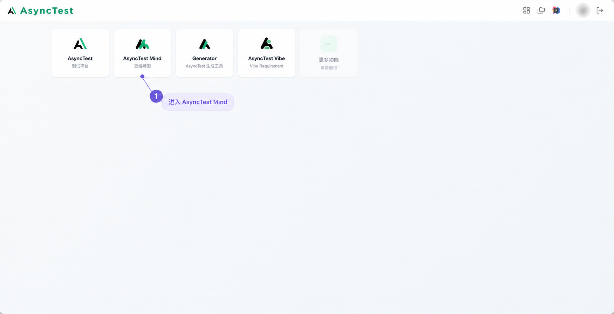
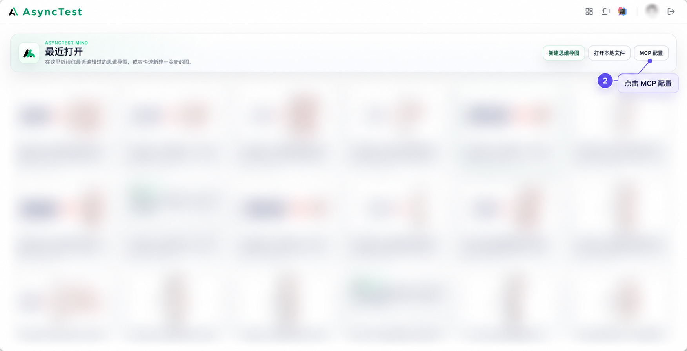
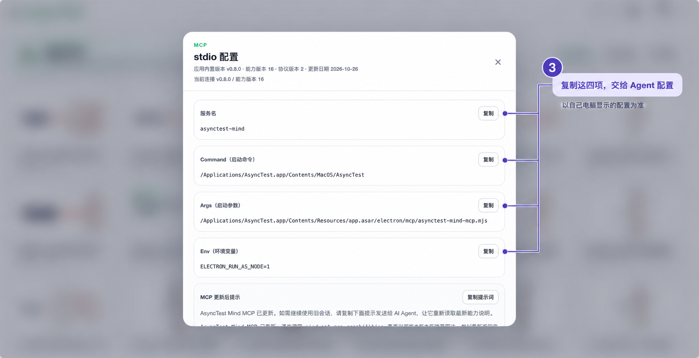

# AsyncTest Mind MCP 接入指引

日期：2026-11-02。依据：用户提供的三张实际界面截图及对应三步说明。本轮已制作带隐私模糊处理的标注图；没有操作应用、配置 MCP 或验证新连接。当前属于设计素材，尚未加入 0.2.1 发布包；完整 3.3 设计已按用户要求与委托定稿，实际实施及接入验证仍待推进。

强烈推荐 asynctest-mind 用于维护思维导图用例，但不强制使用。用户已有工具、格式或可用连接时沿用；只问配置位置时提供指引，不自动安装、改配置或编辑用例。

## 获取配置的三步

### 1. 进入 AsyncTest Mind

打开 AsyncTest，在首页点击 **AsyncTest Mind／思维导图** 卡片。尚未安装时，可先参考 [AsyncTest 下载指引的下载部分](../../skills/qa-workflow/references/asynctest-setup.md)；Mind 的连接信息按本页面取得，不能套用知识库 MCP 配置。

### 2. 打开 MCP 配置

进入 Mind 的“最近打开”页面，点击右上角 **MCP 配置**。不需要为了查看配置先打开或修改某份测试用例。

### 3. 复制自己页面上的连接信息

截图中的弹窗标题为 **stdio 配置**，以下四项各有“复制”按钮：

| 字段 | 交给 Agent 的内容 |
| --- | --- |
| 服务名 | 页面显示的名称，截图为 asynctest-mind |
| Command（启动命令） | 自己电脑上页面提供的完整启动命令 |
| Args（启动参数） | 自己页面提供的完整参数 |
| Env（环境变量） | 页面提供的变量名与值，截图示例为 ELECTRON_RUN_AS_NODE=1 |

把复制的文本交给正在使用的 Agent，例如：

> 这是我从 AsyncTest Mind 复制的 MCP 配置，帮我接入当前客户端，并检查是否可用。

由 Agent 根据当前宿主和实际权限适配配置，不默认用户使用 Codex。截图展示的是 macOS 安装路径及当时版本；其他电脑、系统或安装位置以自己页面为准。优先复制文本，不从标注图 OCR 拼接命令，也不把示例路径固定为所有用户的配置。

下方的 **MCP 更新后提示／复制提示词** 用于页面说明的更新提示场景，不是上面四项连接字段的替代品。按实际更新情况使用；截图中的提示文字不会自动授权配置或执行工具。

## 接入后怎样核对

已经取得接入授权时，由当前 Agent 检查实际客户端配置和可用工具，按最小必要的只读方式核对连接。工具可见、连接可用、目标文档可读和用例保存成功分别说明，不为了验证连接自动新建用例或修改当前文档。需要登录或人工确认时，仅提示实际所需步骤，不从这三张截图推断所有平台的安装和授权流程。

本轮截图中的“当前连接”只代表截图当时界面状态，不是本轮重新连接的证据。安装、客户端配置、连接及端到端用例编辑仍需真实任务验证。

## 素材与展示

- 三张标注图使用蓝紫色编号和细引线，无红框；头像、最近文件名称、日期、缩略图和弹窗外背景中的个人／项目内容已模糊处理。
- 原图在本机私有目录保留，不进入 Git；提交的是经视觉核对的处理副本。
- 图片经内置 imagegen 编辑，为导航示意，不能当作像素保真的原始测试证据。关键配置以实际页面复制为准。
- 当前图片保存在设计目录，后续实施时应将指引和图片一同纳入 Skill 包，并按包内实际位置解析资源。不能依赖作者的本机绝对路径或生成缓存。
- 最终回复图片是否可见、新会话是否能独立找到素材以及其他宿主支持情况，仍按 [真实会话图片验收计划](../../verification/image-display-plan.md) 分别验证。

来源摘要与隐私处理范围见 [素材清单](assets/asynctest-mind/manifest.json)，生成提示词和制作记录见 [记录](../../verification/mind-guide-20261102.json)。

2026-11-03 后续打包：三张图已按原输出字节加入 0.3.0，并提供 [包内接入指引](../../skills/qa-workflow/references/integrations/asynctest-mind.md)。解包路径、摘要和尺寸已检查；本篇保留制作阶段来源，实际客户端接入及新会话图片展示仍待验证。
