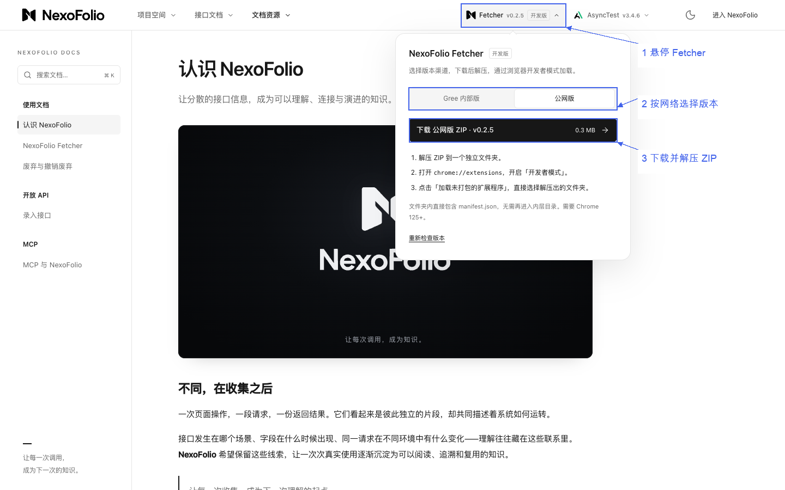
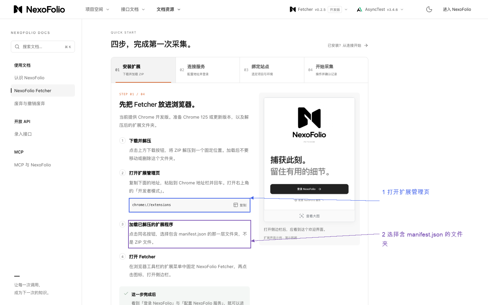
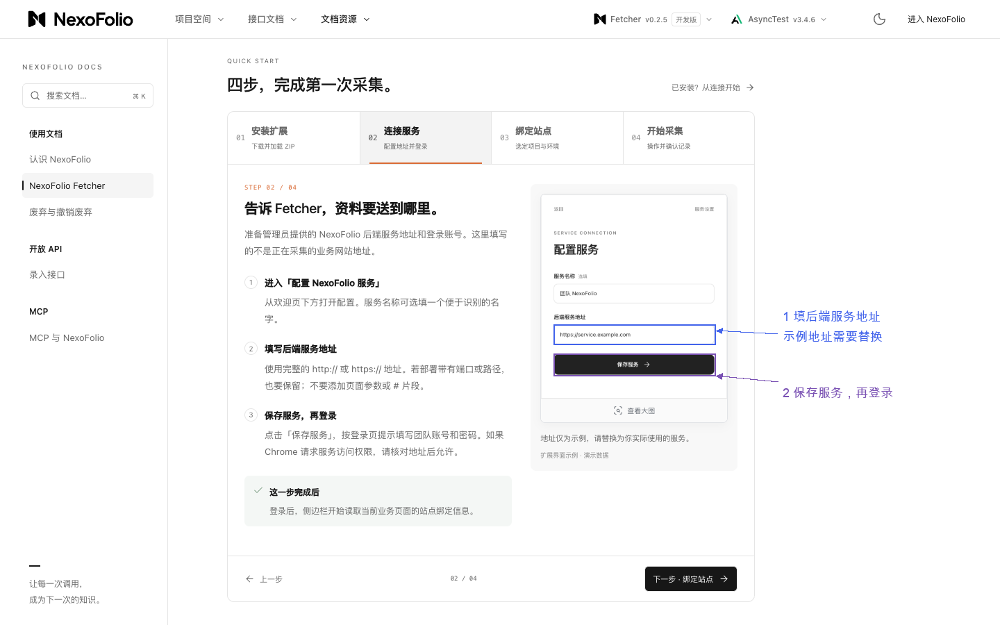
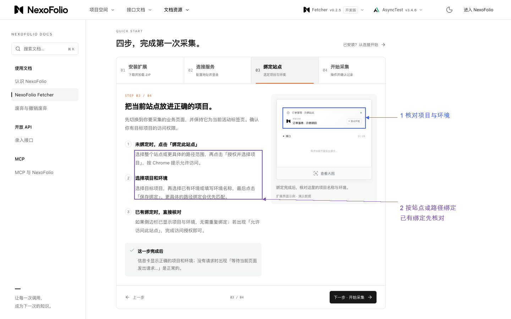
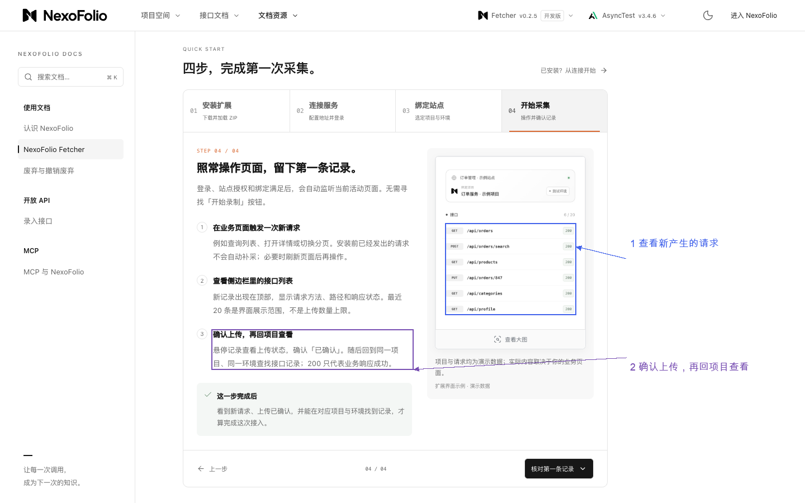
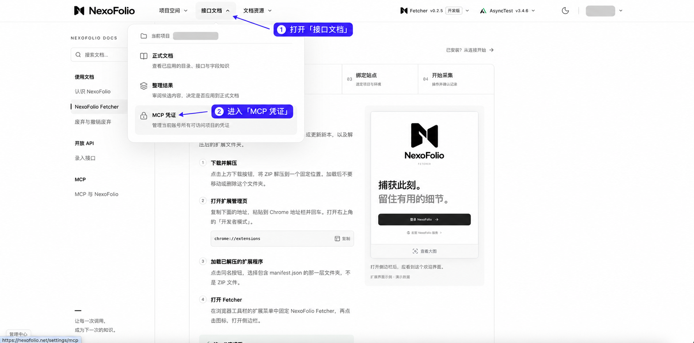
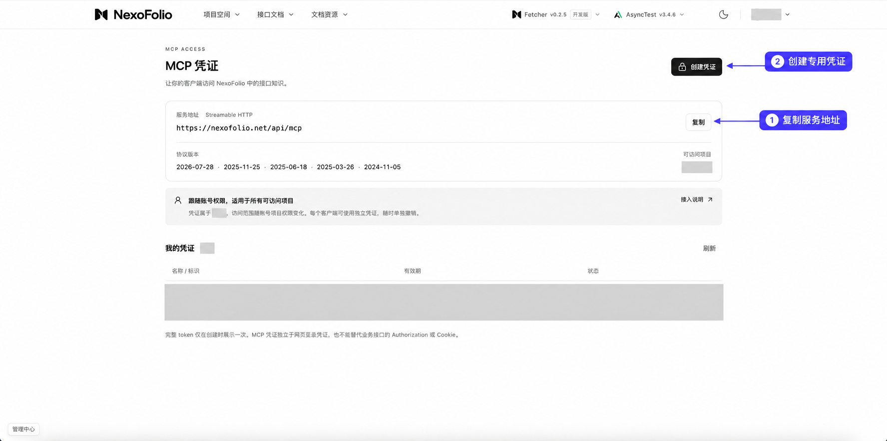
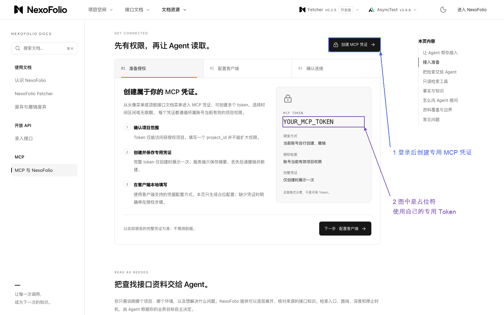
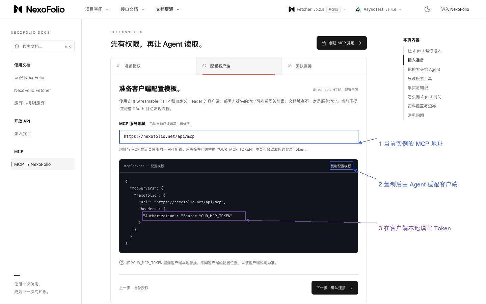

# NexoFolio 使用、Fetcher 安装与 MCP 接入

更新日期：2026-11-03。适用目标是使用已有 NexoFolio 服务，不包含服务器部署。本文按用户提供的地址、外网公开页面和补充截图整理；内网实例本轮未访问。

Agent 按用户当前目标读取对应部分。已有服务、账号或连接可用就复用；安装 Fetcher、连接 MCP、采集上传和执行被测业务是不同动作，按本次范围推进。默认只展示当前步骤需要的图片，避免每次把整份图文全部发给用户。

## 1. 地址与三种用法

| 入口 | 地址 | 用途 |
| --- | --- | --- |
| Gree 内网 NexoFolio | [内网入口](http://10.23.224.40/nexofolio/) | 用户提供的内部平台入口，需所在网络可访问 |
| 外网 NexoFolio | [外网入口](https://nexofolio.net/) | 浏览器访问平台、登录并查看有权限的项目 |
| 产品文档 | [认识 NexoFolio](https://nexofolio.net/docs) | 产品用途、Fetcher 下载入口和相关文档 |
| Fetcher 教程 | [安装与首次采集](https://nexofolio.net/docs/fetcher) | Chrome 扩展安装、连接、绑定和采集 |
| MCP 教程 | [MCP 与 NexoFolio](https://nexofolio.net/docs/mcp) | 专用凭证、实例地址、客户端配置和只读使用 |
| Agent 接入参考 | [mcp.md](https://nexofolio.net/mcp.md) | 官网提供的文本参考入口；本轮未单独核验全文 |
| 外网 MCP 凭证页 | [MCP 凭证](https://nexofolio.net/settings/mcp) | 登录后创建和管理本人的专用凭证 |

NexoFolio 平台通过浏览器使用。需要安装的是采集用的 Fetcher 扩展；只看已有接口资料或让 Agent 读取现有知识时，不要求先安装 Fetcher。MCP 使用远程 Streamable HTTP，不需要编造或安装一个同名 npm 包。

自然引导示例：

- “我想查已有接口”：进入有权限的项目及环境，阅读正式文档；Agent 可通过已接入 MCP 查资料。
- “我想把页面请求收进来”：按 Fetcher 四步完成采集准备，确认采集目标后再操作页面。
- “我想让 Agent 用这些资料”：获取当前实例的 MCP 地址和专用凭证，让当前客户端完成配置。

本轮外网文档及用户的凭证页截图均显示 MCP 地址为 `https://nexofolio.net/api/mcp`。网页地址、Fetcher 后端服务地址、MCP 协议地址应分别核对。内网的 API／MCP 地址以该实例页面或管理员提供的信息为准，不能简单在 `/nexofolio/` 后拼接路径，也不能把被测业务网站地址填成 NexoFolio 服务。

## 2. 平台里怎样看接口资料

1. 打开所需网络的 NexoFolio，按平台提示登录，使用自己的项目权限。
2. 通过“项目空间”选择目标项目。随后从“接口文档 → 正式文档”进入已应用的目录、接口及字段知识，并核对所需环境。
3. 根据业务目录或已知接口／字段线索定位资料，读取接口用途、请求方法与路径、参数、返回结构及必要样本。
4. 对关键结论核对环境、采集时间、原始来源、确认状态和缺口；历史调用结果不能当成当前接口执行结果。

用户补充截图显示“接口文档”下区分“正式文档”“整理结果”“MCP 凭证”。“整理结果”是候选审阅入口，查看或查询不自动授权应用候选、修改资料或更换绑定。

本轮未登录操作正式文档页；以上资料读取原则依据产品及 MCP 文档，菜单入口另有用户截图支持，不将它写成一次真实业务查询验收。

## 3. Fetcher：下载、安装、连接、绑定与采集

当前教程要求 Chrome 125+，采用开发版 ZIP；本轮页面显示 Fetcher v0.2.5。版本和浏览器要求以后以下载页为准，不固定旧 ZIP 地址。

### 3.1 选择下载渠道并安装

在 [产品文档](https://nexofolio.net/docs) 页头悬停 Fetcher，选择 Gree 内部版或公网版，再下载 ZIP。渠道按实际要连接的服务选择，不能因教程截图选中公网就把公司资料采集到公网实例。



解压到固定目录；进入 `chrome://extensions`，开启开发者模式，使用“加载已解压的扩展程序”（不同 Chrome 版本文字可能略有差异），选择直接包含 `manifest.json` 的目录。加载后保留该目录，在工具栏固定扩展并打开侧边栏。



### 3.2 连接服务并登录

从欢迎页进入“配置 NexoFolio 服务”，填写部署方提供的完整后端服务地址，保留所需端口和路径；保存后用团队账号登录。浏览器若请求访问服务地址的权限，先核对目标再处理。图中的 `service.example.com` 是官方演示地址，不能直接使用。



### 3.3 绑定业务站点

切换到要采集的业务页面并保持为活动标签页。无绑定时，从“绑定此站点”选择站点或路径范围，授权后选择正确项目与环境，保存绑定。更具体路径优先匹配；已有正确绑定时直接核对，不重复创建。



### 3.4 确认第一条记录

满足登录、站点授权和绑定条件后会自动采集，无需寻找开始录制按钮。在已授权范围内做一次查询、查看或翻页，检查新请求，再悬停记录核对上传状态，最后在相同项目与环境找到记录。HTTP 200 只说明业务响应，不能证明 NexoFolio 已收到资料。



官网还说明：关闭侧边栏不等于停止采集；界面最近 20 条不等于上传上限；注入前请求、部分 Worker、文件字节和不可读或超限内容不保证完整捕获。采集属于向所配实例上传资料，必须与目标站点、项目、环境和用户授权一致。发现不完整时保留采集状态，不承诺完整网络录制。

以上步骤来自 [Fetcher 官方教程](https://nexofolio.net/docs/fetcher)，截图是教程的真实浏览器截图，其中扩展小窗为官网标明的演示数据。本轮没有安装扩展、登录服务、绑定站点或上传真实接口。

## 4. MCP：从哪里取得信息，怎样交给 Agent

### 4.1 找到凭证页面

用户提供的已登录截图确认入口为“接口文档 → MCP 凭证”；官方文档也提供头像菜单入口。进入的是当前账号的 MCP 凭证管理，不要求每个项目分别创建一个 Token。



### 4.2 复制地址、创建自己的专用凭证

凭证页提供 Streamable HTTP 服务地址及“复制”“创建凭证”入口。按页面创建自己的专用凭证，并在实际创建流程中填写名称、有效期；完整 Token 只在创建时显示一次。访问范围遵循账号当前有效项目权限，示例图中的项目数不是所有用户的固定值。



用户截图支持服务地址、入口及已有凭证列表的布局；创建弹窗的具体控件本轮未打开，有效期和一次展示规则来自官方文档。不要根据截图臆造尚未见到的按钮或自动替用户创建、撤销凭证。

官方授权说明也可作为补充：



MCP Token 独立于网页登录凭据，也不能替代被测业务系统的认证。实际 Token 放在客户端支持的本地凭据渠道，不复制进截图、通用文档或 Git。

### 4.3 配置当前客户端

当前官网展示的通用示例为：

```json
{
  "mcpServers": {
    "nexofolio": {
      "url": "https://nexofolio.net/api/mcp",
      "headers": {
        "Authorization": "Bearer YOUR_MCP_TOKEN"
      }
    }
  }
}
```

这是官网示例，不保证每个客户端接受相同 JSON。由 Agent 核对当前宿主的 Streamable HTTP、自定义 Header 和凭据配置方式，只增改 nexofolio 项，保留其他 MCP。`YOUR_MCP_TOKEN` 必须在本地替换为自己的专用凭证；文档 URL `/docs/mcp` 不是协议端点。当前官网说明没有完整 OAuth 自动发现流程，不把普通网页登录当成 MCP 已接通。



用户可以这样交给 Agent：

> 帮我接入 NexoFolio，先阅读 https://nexofolio.net/docs/mcp。我使用的是这个实例，请按当前客户端的方式配置，保留已有 MCP。专用凭证由我在本地填写。接入后只查询我指定项目和环境的接口资料，先不要发送业务请求或整理、修改资料。

已有连接时先复用和核对，不重复安装；确需用户登录或填写凭证时只说明当前必要的一步。不要要求用户查项目 UUID 或编写配置脚本。

### 4.4 怎样算接入成功

先核对 initialize、服务 instructions 和实际 tools/list，再用用户选定的问题做只读检索。项目和环境可按名称发现，歧义影响结果时再询问；已有明确 ID 则直接复用。当前文档列出 11 个只读工具，数量是本次版本信息，不作为永久硬编码条件。

验证应能定位正确项目与环境，取得支持答案的完整说明或关键字段，说明来源、确认状态和未覆盖资料。仅显示已连接、配置保存成功，或勾选官网教程里的核对框，都不代表实际读取验收完成。

权限拒绝、服务无工具、搜索无结果是不同问题，分别处理。文档或样本不完整时沿工具给出的同版本续读入口取得必要内容；不用历史凭据发送业务请求。

## 5. 在 VeriForge 中怎样使用

NexoFolio 提供接口资料和来源依据，可用于需求澄清、核对字段及数据来源、准备请求草案和分析测试证据。它与 asynctest-kb 的业务规则知识互补，Fetcher 是采集入口，MCP 是只读资料入口；都不自动构成业务接口测试执行器。

例如用户说：

> 在我指定项目的 QA 环境，找出完成审批需要的任务标识来自哪里，准备请求草案并说明缺失信息，先不要发送请求。

Agent 自主选择目录、搜索、字段或已有引用，按需要展开关键证据。陌生项目可以先看目录；已知接口或字段可以直接搜索，不强制固定工具顺序。观测值相同不证明业务必调顺序，生成的候选说明不当成已确认规则；存在资料缺口时返回相应澄清或补采。

后续实际发送 HTTP 请求仍按 3.5 的授权、身份、数据和证据要求执行。当前只读 MCP 不负责应用候选文档、修改 NexoFolio 知识或代替被测业务认证。

## 6. 本轮证据与维护

- 外网公开文档由专用 headless Chrome 实际读取，视口 1440×900，浏览器 UA 显示 HeadlessChrome；未使用日常 Chrome。
- 01—07 为公开文档原始 PNG 加 screenshot-annotator 确定性标注。原图、标注规格、输出及证据摘要一同保存；蓝紫色提示与原文字分开。
- 08—09 基于用户提供的已登录截图，由 imagegen 生成遮挡个人信息的导航示意；不宣称逐像素保真或由 Agent 登录取证。原图只保存在本机忽略目录，公开输出不包含用户姓名、头像或已有凭证记录。
- 创建凭证的弹窗、实际安装、登录绑定、真实采集上传、客户端配置及 MCP 业务读取验收均未在本轮执行。内网入口由用户提供，内网 API 路径未验证。
- 图片来源与摘要见 [素材清单](assets/nexofolio/manifest.json)，处理及核对记录见 [验证记录](../../verification/nexofolio-guide-20261103.json)。本指南与图片属于仓库中的设计接入资料，尚未加入或重新发布 0.2.1 安装包。

后续平台导航、下载渠道、配置方式变化时，针对变化重新核对和替换图文，保留旧版来源；不因页面计数或版本号变化自动修改业务规则。用户询问 MCP 时优先展示 08—09，配置格式不清再展示 07；已安装 Fetcher 的用户直接从连接或绑定步骤继续。

2026-11-03 后续打包：九张允许分发的图已按原输出字节加入 0.3.0，包内使用 [精简指引](../../skills/qa-workflow/references/integrations/nexofolio.md)；本篇保留完整制作来源。解包后的路径及图像摘要已检查，真实安装采集、客户端连接和新会话展示仍未因打包完成而验收。
