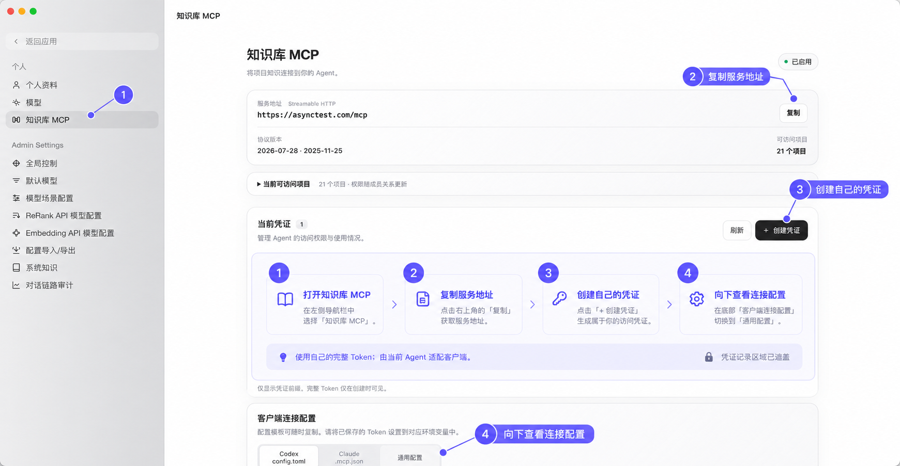

# AsyncTest 下载与知识库接入

用户需要历史规则时，先说明收益：“我可以先查这个项目以前的规则，把已有背景补起来，再问你这次真正缺少的部分。”没有 MCP 也能使用已有资料继续，不把可选工具变成入门门槛。

## 下载与登录

1. 打开 [NexoFolio 文档入口](https://nexofolio.net/docs)。
2. 将鼠标移到顶部 **AsyncTest**，按自己的服务选择相应下载渠道，再选操作系统和芯片架构。
3. 安装后打开 AsyncTest，使用自己的账号登录。组织部署的地址、账号申请方式由自己的服务提供方提供；VeriForge 不预设组织入口。
4. 版本、安装包和菜单以当前页面为准。下载或登录卡住时说明具体环节，不自行切换服务。

## 获取 asynctest-kb MCP 信息

打开 AsyncTest 设置 → **知识库 MCP** → 复制服务地址 → 创建自己的凭证 → 查看客户端连接配置。Token 仅在创建时完整展示时，应立即存入本机安全存储。已有凭证不能凭前缀补全。

让当前 Agent 根据宿主实际支持的 MCP 配置格式协助接入，优先沿用宿主的凭据机制；不默认用户使用某款客户端，也不默认 Agent 一定具有修改全局设置的能力。没有此权限时只说明需要用户完成的具体一步。

连接后核对可用工具、可访问项目及一条相关历史规则。服务已启用、工具可见和业务知识可读是三个不同结果。按 [历史知识与项目补全](context-bootstrap.md) 使用，私密信息见 [凭据存储](privacy.md)。

图片仅帮助定位入口。展示时将包内路径转换为当前宿主支持的绝对本地路径；不支持内嵌图片时保留文字步骤和文件入口，不声称所有 Agent 都能直接显示。
