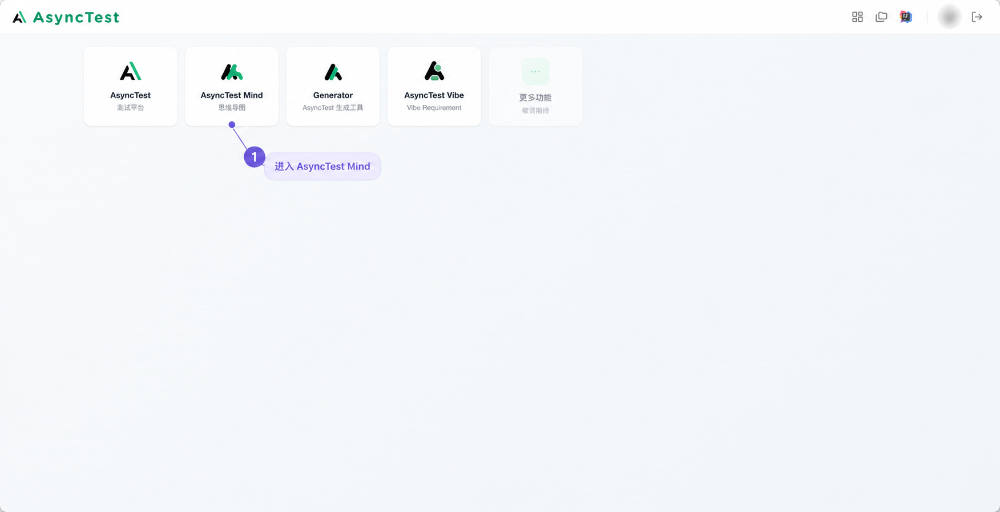
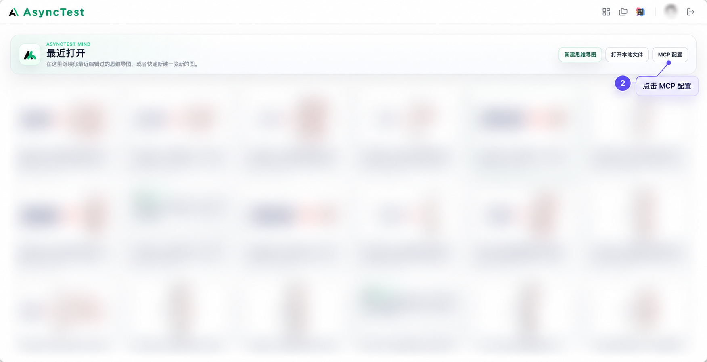
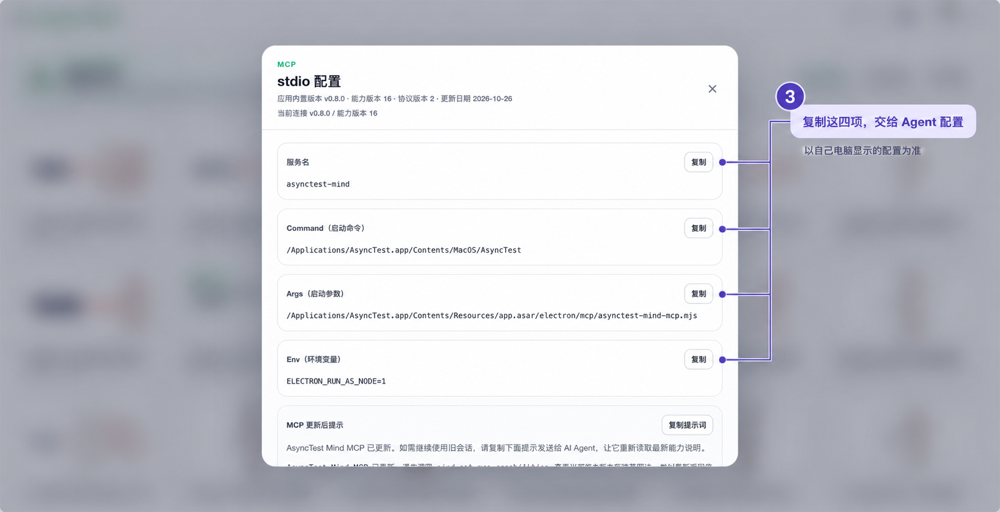

# AsyncTest Mind 接入

强烈推荐思维导图用例，用户格式优先。先检查实际工具和已有连接，不因当前不可见就循环重装；需要下载 AsyncTest 时用[下载与知识库指引](../asynctest-setup.md)。

1. 打开 AsyncTest，进入 AsyncTest Mind。
2. 在最近打开页点击 MCP 配置。
3. 复制自己机器页面中的服务名、Command、Args、Env，交给当前 Agent 按实际客户端格式接入。图中 macOS 路径只是示例，不硬编码给其他用户。

按用户当前步骤展示相应图片，不默认一次发送全部：

这些是基于用户截图制作的导航示意，个人信息已处理，不是当前机器安装验收。已有连接则复用；连接保存、工具可见和实际正确读写分别核对。

编辑先 outline，再按需 subtree；用一次批量事务或大批新增，随后保存。多窗口明确 windowKey，绑定画板和稳定节点 ID，使用实际 revision 保护；不关闭用户窗口后离线重写 .amind。磁盘转换按真实工具支持，读取已保存版本，保留覆盖保护和格式 warnings。

写入超时先查询操作状态，不重放进行中的操作；用户退出控制后停止业务调用，只有明确恢复意图才按工具协议请求恢复和提示必要客户端操作。结束任务清理 Agent 连接，不能把它理解成关闭文档。

结果标记与场景身份单独映射，保留无关标记。最新工具定义是实际参数依据，截图显示的版本和数量不永久写死。
