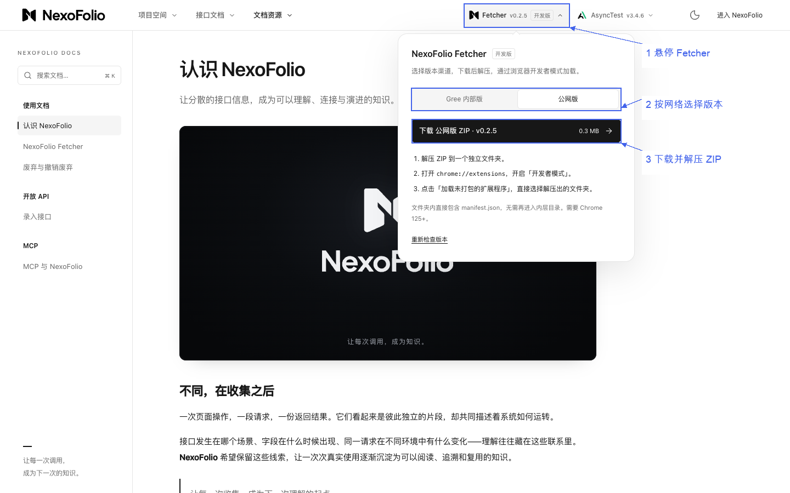
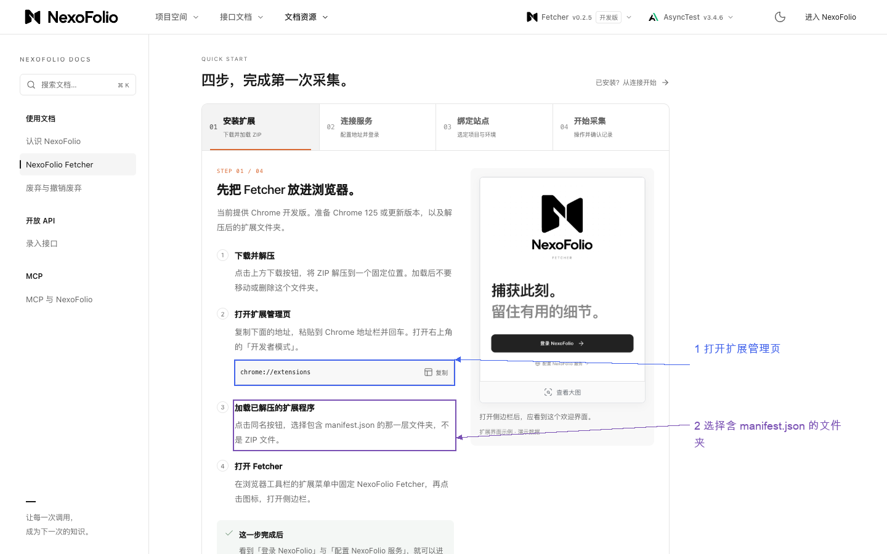
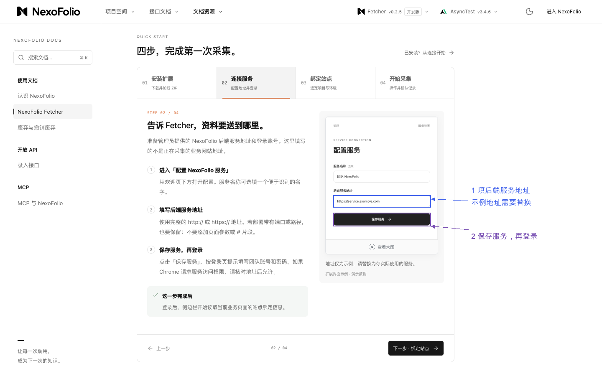
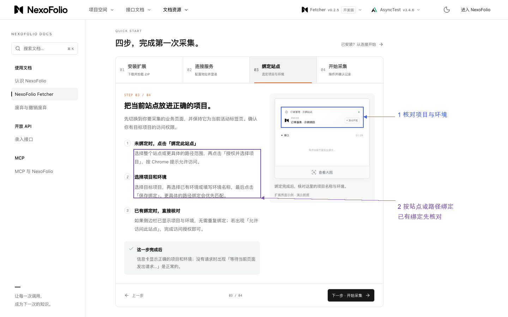
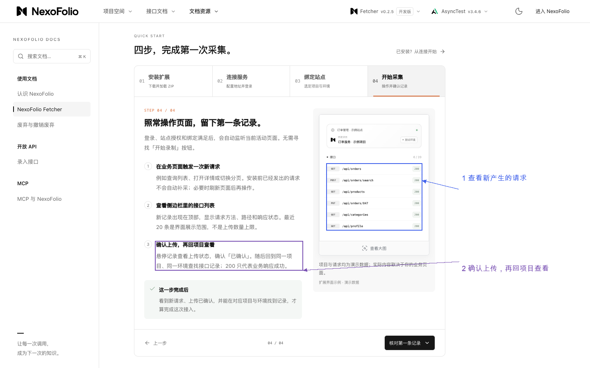
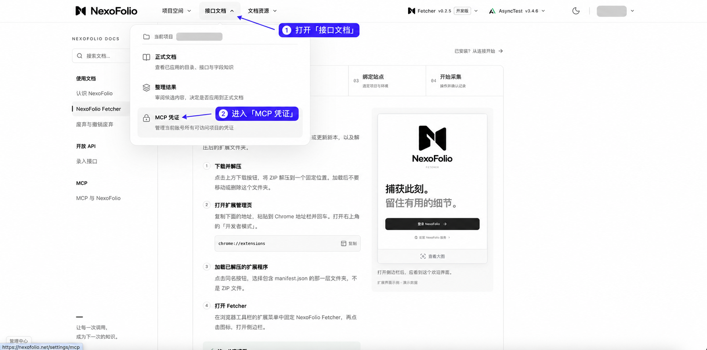
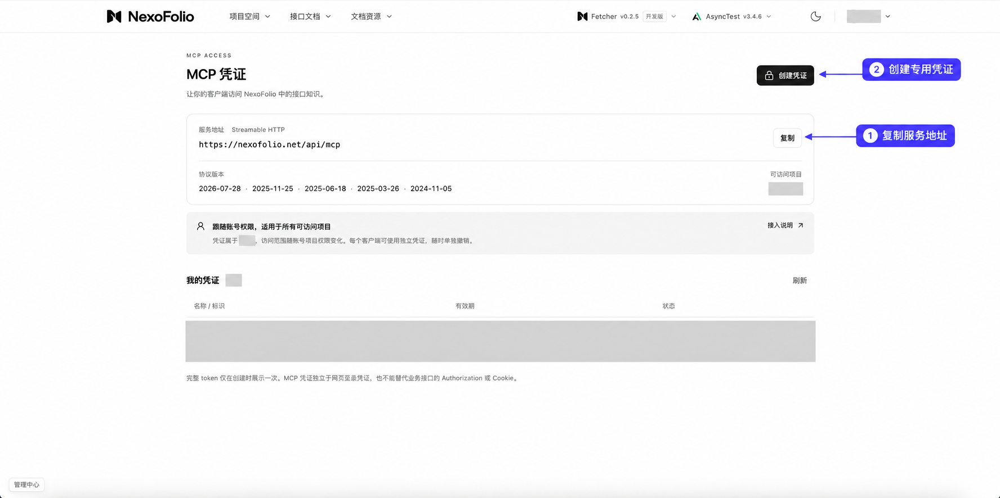
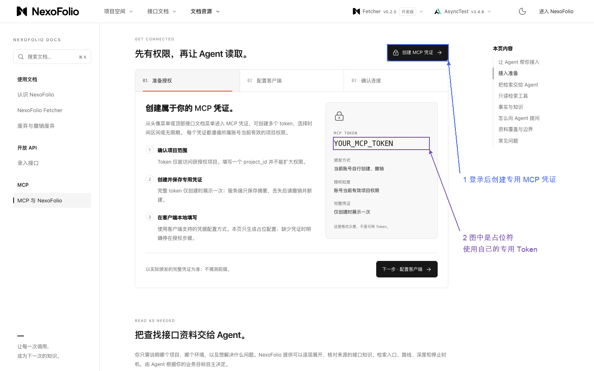
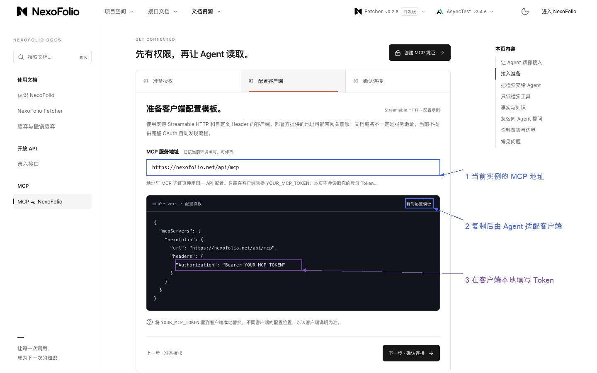

# NexoFolio、Fetcher 与只读 MCP

NexoFolio 网页平台用于阅读接口资料；Fetcher 是采集扩展；MCP 让 Agent 查询已有接口知识。只查资料不要求先安装 Fetcher。它们不能自动替代本轮业务接口测试。

## 入口

- [外网 NexoFolio](https://nexofolio.net/)／[文档](https://nexofolio.net/docs)
- [Fetcher 教程](https://nexofolio.net/docs/fetcher)
- [MCP 教程](https://nexofolio.net/docs/mcp)／[外网凭证页](https://nexofolio.net/settings/mcp)
- Gree 内部实例参考：[内网入口](http://10.23.224.40/nexofolio/)。仅用户明确使用该组织实例时采用；其他团队使用自己提供的地址。

网页入口、Fetcher 后端服务和 MCP 协议地址分别核对，不从内网页面前缀拼造 API。外网教程显示 MCP 地址为 `https://nexofolio.net/api/mcp`，其他实例以当前页面为准。

## 平台和 Fetcher

登录后选择目标项目与环境，从“接口文档 → 正式文档”阅读目录、接口、字段和来源。整理结果是候选审阅入口，查询不授权应用修改；实际观测、候选说明和已确认语义分别判断。

需要采集时，按官方教程：页头 Fetcher 选择内网或公网渠道 → 下载 ZIP 并解压 → Chrome 扩展页开启开发者模式、加载含 manifest.json 的目录 → 配置实际后端服务并登录 → 在授权业务站点绑定项目与环境 → 操作页面并核对上传状态及项目记录。

版本和浏览器要求以当前页面为准。截图中的示例服务地址不能直接使用；关闭侧边栏不等于停止采集，HTTP 200 不证明资料上传完成，部分 Worker／文件／不可读响应可能未完整保留。采集会向所配实例上传，先核对范围。

按当前步骤展示对应图，不一次发送全部：

## MCP 信息交给 Agent

用户可从“接口文档 → MCP 凭证”取得当前实例地址并创建自己的专用凭证。完整 Token 仅创建时展示，按账号当前项目权限访问；不能用网页登录 Token 或历史业务 Header 替代。

让当前 Agent 按实际客户端的 Streamable HTTP 和 Authorization Header 支持配置，保留已有其他 MCP；Token 在本地填写，不进入图文或日志。无需猜 npm 包，不默认所有客户端使用同一 JSON。

接入后核对 initialize、服务说明和实际工具定义，再用用户选定问题验证一次只读检索。项目环境可按名称发现，歧义才询问。按目录、搜索、字段或引用自主选路，关键资料读完整，保留来源、确认状态和未读范围。

例如：“在指定项目的 QA 环境查清审批任务标识来自哪里，准备请求草案，先不要发送请求。”相同观测值不证明必调顺序，说明已生成不等于语义已确认。服务连接、真实读取、业务请求执行分别验收。

图片只作导航。01—07 是公开文档截图的确定性标注，内嵌扩展为官方演示数据；08—09 是用户截图经生成式遮挡制作的示意，不能当像素保真的测试证据。真实登录、安装、采集和新会话展示在本包中仍未验收。
