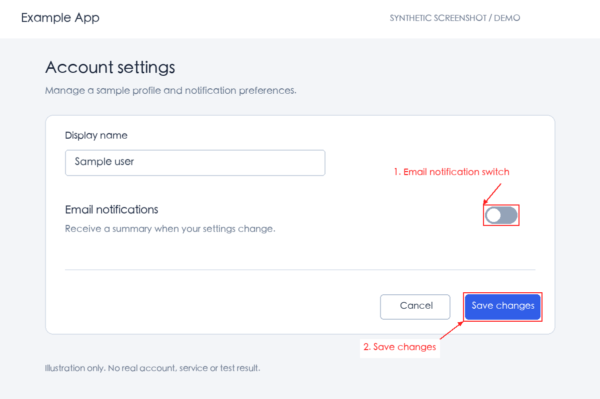

# Screenshot Annotator

**Local screenshot annotations for issue reports and interface reviews.**

Version 0.1.0 · MIT · Maintained by project contributors.

An agent or person identifies a region and supplies a label. This tool adds boxes, arrows and multilingual text to a copy of the screenshot and records where the coordinates came from. It does not recognize controls, diagnose bugs, run a browser test suite or submit tickets.



## Setup

Requires Python 3.10+ and Pillow. The release pins Pillow 12.3.0. A font with the characters used in the labels is also required; no fonts are redistributed.

macOS / Linux, from the extracted directory:

```sh
python3 -m venv .venv
.venv/bin/python -m pip install -r requirements.txt
.venv/bin/python scripts/annotate.py examples/settings.png examples/annotations.json annotated.png
```

Windows PowerShell:

```powershell
py -3 -m venv .venv
.venv\Scripts\python.exe -m pip install -r requirements.txt
.venv\Scripts\python.exe scripts\annotate.py examples\settings.png examples\annotations.json annotated.png
```

Use a new output filename for each run. Offline environments may install the pinned dependency from an approved local wheel cache. An existing Python environment with the dependency is also sufficient.

## Use with an agent

Install this directory as a skill using your agent's supported local skill mechanism, or provide its `SKILL.md` directly. For example:

> Use screenshot-annotator to highlight the email-notification switch and the Save changes button in this screenshot. Add numbered Chinese explanations and preserve the original.

The agent selects coordinates, writes the JSON and inspects the result. Core drawing is independent of the agent vendor. `agents/openai.yaml` supplies optional Codex discovery metadata.

## Fonts

The renderer checks common system font paths. For Chinese labels, install a font with Chinese coverage, such as Noto Sans CJK, or provide an existing font explicitly:

```sh
python scripts/annotate.py input.png annotations.json output.png --font /path/to/font.ttf
```

`ANNOTATE_FONT` is also accepted. An explicit missing font is an error; it is not silently replaced. Glyph coverage is not automatically proven: inspect the output for missing-glyph boxes, especially for emoji, uncommon scripts and mixed-language labels. On Linux the font may need to be installed separately. On Windows use the direct Python command; Bash is optional.

## Inputs and outputs

- Inputs: a single-frame PNG, JPEG or WebP screenshot and a JSON specification. See [the format reference](references/annotation-format.md).
- Outputs: `output.png` plus `output.evidence.json`. The latter contains hashes, final coordinates, labels, location sources, tool/runtime versions and font filename.
- Absolute local paths are omitted unless `--include-paths` is supplied. Filenames and labels are user data and are not automatically redacted.
- Existing files are never overwritten. Ordinary write errors roll back files newly created by that operation. Two separate files cannot be guaranteed to commit atomically across a process kill or power failure; a successful exit and a matching evidence hash indicate a completed pair.
- Labels can be placed automatically or explicitly. Automatic layout avoids all supplied target boxes and other labels; it does not detect page content or prevent arrows from crossing it. Review the result.

The Python command works without Node.js or a browser. The optional [Playwright adapter](references/browser-capture.md) takes a page and locator from an existing test; it is not a standalone browser runner.

## Limits

Up to 100 annotations; source image up to 50 MiB / 40 million pixels; JSON up to 1 MiB; each label up to 1,000 characters. Only 8-bit RGB/RGBA, grayscale and palette inputs are supported. Animated images and rotated EXIF orientations are rejected with guidance. Image metadata other than the ICC color profile is not copied. No OCR, generative image editing, masking/redaction, full-page coordinate conversion or ticket integration is included.

## Validation

```sh
python -m unittest discover -s tests -v
node --test tests/capture-target.test.cjs
```

Python tests use temporary synthetic images. Node tests exercise the optional adapter's contract and failure cleanup with fake page objects; they are not real-browser acceptance tests. Node 20+ is sufficient for that suite.

Release checks were run on macOS with Python 3.11 and 3.12, Pillow 12.3.0. Linux/Windows instructions are provided, but native runs on those operating systems have not been performed. An additional first-use agent session is assessed separately from the package tests.

## Distribution and maintenance

The ZIP contains `SKILL.md` and `requirements.txt` at its root. Version is stored under `metadata.version` for skill compatibility; platforms that only read a top-level `version` may not show it automatically. A ZIP being accepted does not imply that a registry installs dependencies or executes scripts.

This package includes no real account data, company screenshots, internal hostnames, API keys or personal absolute paths. The sample image is synthetic and labeled accordingly. Source code, documentation and synthetic examples are covered by [LICENSE](LICENSE); dependencies retain their own licenses. To report an issue to the distributor, include the version, Python/Pillow versions, a minimal specification and a synthetic or sanitized screenshot. No personal contact or repository URL is embedded.
